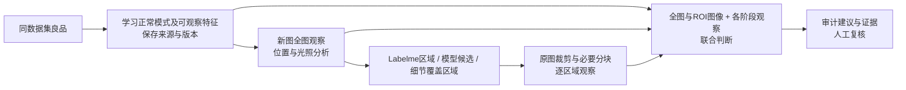

# 良品知识驱动的全图与 ROI 多模态审计

## Problem Statement

质检人员需要模型先理解同数据集良品的正常结构、纹理、位置和光照变化，再对新图进行全图与局部检查，最终给出有图像证据、可复核的完整建议。只有文本总结不足以证明模型在最终判断时看到了图像，也不能证明缩小后的概览覆盖了细小缺陷。

## Solution

良品学习、全图观察、ROI 观察和最终判断均由项目既有 MLLM 完成。裁剪、坐标映射和证据存储仅是配套工具。复用良品版本库、审计作业与人工复核入口，建立“良品语义知识 → 全图观察 → 原图 ROI 细看 → 带图联合判断”的单一路径。

这里的“良品特征”是可解释的视觉语义知识；不把文本描述或原始向量冒充已训练的视觉记忆网络。证据不足、检查失败或观察互相矛盾时，保留不确定性并交给人工复核。

## User Stories

1. 作为质检人员，我希望从同数据集良品学习正常结构，从而让审计以该产品的正常模式为依据。
2. 作为质检人员，我希望学习结果区分结构、纹理、位置和光照变化，从而理解模型认为哪些差异是允许的。
3. 作为质检人员，我希望知道初始无标注良品约定与人工确认的来源，从而判断知识的可靠程度。
4. 作为质检人员，我希望待审图不参与自身良品知识学习，从而避免把缺陷学为正常。
5. 作为质检人员，我希望参考图变化后自动产生新的知识版本，从而不继续使用失效模式。
6. 作为复核人员，我希望回看审计当时的知识版本，从而解释历史结论。
7. 作为质检人员，我希望模型先看全图，从而掌握整体结构、相对位置与成像条件。
8. 作为质检人员，我希望 Labelme 标注成为需要验证的线索，从而避免模型直接照抄标注类别作结论。
9. 作为质检人员，我希望模型能提出标注之外的可疑区域，从而发现潜在漏标。
10. 作为质检人员，我希望 ROI 从原图裁出并保留周边上下文，从而检查小缺陷与局部结构。
11. 作为质检人员，我希望超大区域能分块检查，从而避免再次缩图丢失细节。
12. 作为质检人员，我希望无标注图片也有明确的局部覆盖策略，从而不把“没有提出 ROI”误认为“已检查无异常”。
13. 作为复核人员，我希望看到每个 ROI 的来源、原图坐标与实际送模尺寸，从而核验定位和细节。
14. 作为复核人员，我希望点击实际审计证据图放大，从而验证文字观察是否符合图像。
15. 作为质检人员，我希望最终阶段重新看到全图和 ROI 图，从而降低只根据中间文字作判断的风险。
16. 作为质检人员，我希望最终结论关联具体证据，从而知道异常判断来自哪里。
17. 作为质检人员，我希望结论解释位置与光照因素，从而区分缺陷、偏移和反光。
18. 作为复核人员，我希望观察矛盾与缺失证据被明确显示，从而优先处理有疑问的样本。
19. 作为操作人员，我希望默认审计当前筛选的全部图像及其全部计划 ROI，不设置总图像数量或 ROI 预算。
20. 作为操作人员，我希望单图与批量使用同一异步作业，从而在多阶段检查时持续看到状态并能取消。
21. 作为复核人员，我希望模型建议保留为独立来源，从而不会覆盖原始数据质量和人工裁决。
22. 作为维护人员，我希望最终效果用真实图像与当前 MLLM 验证，从而区分链路可用与检测质量已达标。
23. 作为操作人员，我希望逐图刷新网格、样本详情和统计，同时保留打开的查看器与输入。

## Implementation Decisions

- 采用可审计的固定多阶段编排；借鉴分层视觉取证与领域知识的方向，继续使用项目现有 MLLM，不引入新模型训练或宣称复现论文指标。
- 良品知识模块继续承担学习、缓存、版本与来源的唯一职责；版本指纹包含参考身份及内容、模型、提示与知识结构版本。人工裁决影响参考资格，待审图始终排除。
- 良品语义结构明确表示可观察的正常特征、允许变化及局限；历史版本不可覆盖。外部论文中的专家知识与当前数据集自动归纳知识分别标明来源。
- 使用统一的视觉证据类型：角色、来源、原图大小、原图坐标、实际传输大小、处理方式和内容指纹。图像传输和坐标变换只由一个模块负责。
- 全图概览用于整体结构，不当成全分辨率细节检查；原图 ROI 以无损图像提供。超大 ROI 分块，坐标统一映射回原图，不要求 MLLM猜测缩放坐标。
- ROI 来源为有效 Labelme 标注、模型候选与高分辨率细节覆盖。去除相同区域的重复请求，但不静默遗漏标注；无标注场景也记录覆盖计划。
- 当前筛选命中的全部图像进入作业，全部计划 ROI 均逐个检查；单图失败保留错误，不写入不完整建议。单次请求按有限图像组分批，不截断总覆盖范围。
- 局部分析同时得到良品知识、相关全图观察、定位信息与 ROI 图像。标注标签是线索，不是缺陷真值。
- 每个叶批次由 MLLM 接收良品知识、全图、该批全部 ROI 图和对应观察。多批次时递归汇总，每个父批次接收全图、各子批次代表 ROI 与完整子结论，所有原始 ROI 均已在叶批次带图判断。保存每步图像输入、子步骤和原始结论，证据引用必须有效。
- 总结论解释位置、光照、矛盾与缺证；前序批次异常不能被后续 PASS 静默覆盖，存在冲突或缺证的 PASS 降为 UNCERTAIN。
- 审计记录保存知识版本、视觉证据、逐阶段观察及结论；界面复用既有共享查看器回看证据，保留人工复核边界。
- 单图与批量统一通过既有异步作业启动、状态与取消接口；页面以单一作业轮询源读取阶段进度，逐图完成后刷新网格、详情和统计，不重置查看器或复核输入。活动作业约每 1.2 秒轮询，空闲约每 5 秒；刷新存在查询延迟，不是流式推送。

## Testing Decisions

- 优先通过既有工作台公开操作链验证：导入/选参考 → 启动作业 → 读取状态和样本证据。使用真实 SQLite、真实图像文件与裁剪模块，只在外部 MLLM HTTP 边界替换响应；不 mock 内部模块。
- 复用既有工作台作业测试与 HTTP/Python 桥接测试；测试行为与可读取的证据，不以私有方法、数据库实现细节或调用次数替代验收。
- 边界覆盖：知识复用与失效、目标排除、坐标映射、无标注与大 ROI、超过原 50 张上限、全部 ROI 分批且异常不丢失、联合请求确有全图和局部图、证据引用有效、取消后无迟到建议、原始标签不变。
- Firefox 通过工作台验证证据展开、全图/ROI 放大、阶段状态、取消及批量未结束时的逐图刷新，刷新保持查看器；不重复测试未变更的查看器数学细节。
- 最后用已授权的同数据集两张真实目标图和良品，在隔离数据库调用既有局域网 MLLM。保存请求证据摘要、阶段结果、耗时和覆盖情况；完成链路不等于证明准确率。
- 开发时仅运行当前切片的测试和类型检查；全部功能完成后统一回归一次。

## Out of Scope

- 本轮不训练、微调或更换 MLLM，不承诺论文中的检测指标。
- 本轮不接入 DINO、PatchCore 等其他检测或特征提取模型，不用传统检测模型替代 MLLM审计。
- 不新增在线网页检索作为生产审计依赖，不自动从互联网学习此私有数据集的正常模式。
- 不自动修改原始质量、人审结果、Gold 或现有 Labelme 文件。
- 不把两个样本的功能验证描述为统计意义的质量验收。

## Further Notes

外部研究、来源核验与原论文/本项目工程取舍的界限，统一见[研究记录](../research/mllm-industrial-audit.md)。当前实现入口统一见[架构索引](../architecture.md)。
