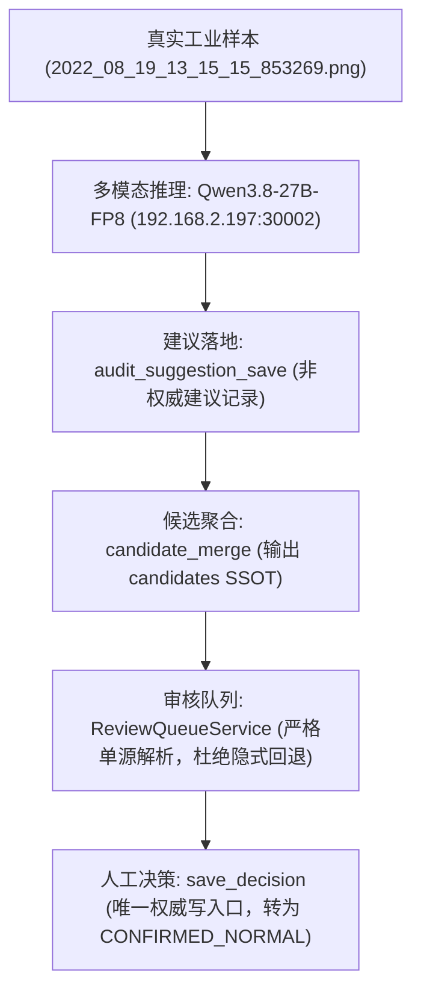

# 真实多模态大模型端到端质检验收报告 (NXM-07, NXM-14)

## 1. 运行环境与模型配置
- **模型端点**: `http://192.168.2.197:30002/v1`
- **模型名称**: `Qwen/Qwen3.8-27B-FP8` (vLLM 原生 OpenAI-compatible Server)
- **鉴权方式**: Bearer Token (`sk-123456`)
- **真实工业样本**: `kuangjiao_dataset:ExportImage_框胶10x连线蓝色背面厚_0904-Test/2022_08_19_13_15_15_853269.png`
- **图像路径**: `/data1/wt/data/框胶数据集/ExportImage_框胶10x连线蓝色背面厚_0904-Test/2022_08_19_13_15_15_853269.png`
- **文件体积**: 1,745,055 字节 (PNG)

---

## 2. 端到端链路验证流 (SSOT Invariant)

### 关键验证指标与证据

| 验证环节 | 预期规范 | 实测结果 | 证据凭据 |
|---|---|---|---|
| **VLM 多模态推理** | 返回真实 Token 消耗与推理逻辑 | 消耗 1,426 tokens（Prompt: 1276, Completion: 150），返回完整图像视觉质检思维链 | [live_vlm_evidence.json](file:///data1/wt/Industrial-Benchmark-Agent/runs/acceptance/live_vlm_evidence.json) |
| **建议非权威边界** | 模型建议不得篡改 `Sample.quality_status` | 样本质量状态保持 `UNCERTAIN`，仅作为证据辅助 | [test_live_vlm_e2e.py](file:///data1/wt/Industrial-Benchmark-Agent/tests/test_live_vlm_e2e.py#L115-L125) |
| **候选集 SSOT** | `merged_candidates.json` 输出 `candidates` 单源 | 顶级输出 `candidates` 数组，来源包含 `LLM`，无重复计算 | [test_live_vlm_e2e.py](file:///data1/wt/Industrial-Benchmark-Agent/tests/test_live_vlm_e2e.py#L130-L150) |
| **审核队列解析** | 严格解析候选，失败报错不隐式回退 | `ReviewQueueService` 载入 1 条候选，无 SQLite 全量回退 | [service.py](file:///data1/wt/Industrial-Benchmark-Agent/python/iad_core/review/service.py#L85-L115) |
| **审核决策落地** | 人工决策作为唯一权威写入口 | 决策录入 `NORMAL`，记录审核人 `expert_operator` | [live_vlm_evidence.json](file:///data1/wt/Industrial-Benchmark-Agent/runs/acceptance/live_vlm_evidence.json#L32-L36) |

---

## 3. VLM 质检思维链实录截选

> **Qwen3.8-27B-FP8 推理分析输出**:
> 1. **分析任务**：用户要求作为工业缺陷质检专家，对提供的手机屏幕点胶/框胶图像进行视觉检查，判断是否存在断胶、溢胶或瑕疵，并给出简要结论。
> 2. **观察图像**：
>    - 图像是一张蓝色背景（屏幕或背板）的局部特写，展示了边缘的框胶（密封胶）轨迹。
>    - 框胶主要分布在图像的右侧边缘和底部边缘，形成一个直角。
>    - 胶体呈现半透明/亮蓝色，边缘清晰。
>    - 胶线连续、粗细均匀，未见局部断胶或异常溢出。
